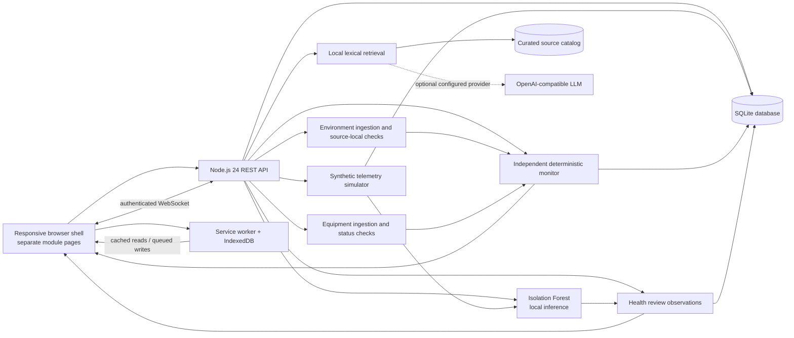

# ASTRA architecture

## Local runtime

The prototype uses Node.js built-in HTTP, SQLite, WebSocket framing, crypto, and filesystem APIs. The browser client is dependency-free JavaScript and CSS. Existing project stack inspection found a functioning Node/SQLite application and test suite; new modules extend that working stack instead of replacing it with an unverified stack.

## Reading flow

1. The client or simulator sends a timestamped health, environmental or equipment sample.
2. Validation checks supported fields, source, timestamp, declared units and quality.
3. SQLite stores source, quality, data class and simulated status with each sample.
4. Simulation-only model inference compares generated health readings with generated references; imported records are not scored by this model.
5. SENTINEL applies data-quality, source-local rolling-deviation, equipment-state and stale-stream checks. Statistical shifts are observations, not physiological or mission safety limits.
6. Findings include the sample, source, quality, baseline or context and detection method, and are broadcast to authorized clients.
7. Authorized medical users can acknowledge or resolve an observation; actions are recorded and audited.

The simulation follows this same persistence, inference, alert and broadcast path. Seed data and all simulator scenarios are marked synthetic.

## Authentication and privacy boundaries

- Passwords use Node scrypt with unique salts for accounts created after seeding.
- JWT access tokens last 15 minutes; a refresh token rotates on use and expires after seven days.
- Logout revokes the associated session, so its access token is rejected immediately.
- API handlers check role and astronaut assignment on every sensitive read/write.
- WebSocket tickets are one-use and expire after 30 seconds; the long-lived token is not put in the stream URL.
- Assistant context is restricted to the authenticated user's astronaut scope.
- Access and administrative events are audit logged; raw health values are not written to ordinary server request logs.

The demo uses local browser storage for tokens and cached records, and does not encrypt browser IndexedDB. Deploy only to a trusted, access-controlled environment after a security review.

## Persistence map

`backend/schema.sql` creates roles, users, refresh sessions, reset tokens, missions, astronauts, baselines, health readings, sleep/activity records, wellness assessments, radiation readings, environmental sensors/readings, equipment/readings/maintenance, SENTINEL observations/actions, anomaly predictions, alerts and acknowledgements, assistant conversations/messages, knowledge documents, simulation sessions, sync queue entries, and audit logs. Indexes cover recent per-astronaut readings and alert status/time. SQLite schema initialization uses idempotent `CREATE TABLE IF NOT EXISTS` statements and additive migrations preserve existing rows.

## Offline behavior

The service worker caches the application shell. IndexedDB stores successful GET responses and a pending write queue. The browser uses cached API responses after a network failure and sends queued health/wellness records to `/api/sync` on reconnection. Client IDs make the health-reading sync path idempotent.

This is browser offline support, not flight-qualified storage. Local model inference continues when the local server is available without internet; if the local server itself is stopped, the browser can show cached data and queue writes but cannot execute the backend Isolation Forest.

## Retrieval assistant

The local knowledge store includes curated short summaries and links for NASA HRP, NASA OSDR, NASA GeneLab, ESA exploration and PhysioNet MIT-BIH. Retrieval ranks matching terms locally. Admins can add text from approved sources through a protected ingestion endpoint; text is split into bounded chunks. This build does not extract PDF files or create vector embeddings. If an OpenAI-compatible endpoint is configured, the assistant sends only the user's query and the authorised context to that endpoint; monitoring and local fallback do not depend on it.

## Research and safety limits

- The Isolation Forest is trained on generated, standardized reference telemetry. Holdout evaluation uses generated labels and is only a software check.
- No clinical sensitivity, specificity, diagnosis, or medical probability is claimed.
- No live hardware, NASA astronaut record, or external medical data connector is connected.
- Immune and bone-health pages are research scaffolds until validated measurements and protocols are available.
- The app is not a certified medical device and must not be used for operational care.
